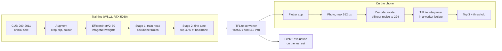

# BirdLens

An Android app that identifies 200 bird species from a photo, entirely on the phone, using a TensorFlow Lite model I trained on CUB-200-2011.

<p>
  
  
  
  
  
</p>

## The problem

Most bird ID apps upload your photo to a server. I wanted to see how well a small model can do running only on the phone: no upload, works offline, quick enough to feel instant. That meant training my own classifier, shrinking it for mobile, and proving the phone gives the same answers as my Python evaluation.

## What the app does

- Take a photo or choose one from the gallery, and see the top 3 species with confidence bars.
- If the top guess is weak, it says "Not confident, this may not be one of the 200 species I know" instead of pretending.
- Keeps a local history of scans (thumbnail, top guess, confidence, time) that you can delete.
- A benchmark screen times the model on the device. An About screen explains what the model can't do.

## Results

Measured on the official CUB-200-2011 test set (5,794 photos), running each `.tflite` file through the LiteRT interpreter (`training/evaluate.py`):

| Model file | Size | Top-1 accuracy | Top-5 accuracy | Macro F1 |
|---|---|---|---|---|
| float32 | 24.5 MB | 75.2% | 92.8% | 0.752 |
| **float16 (in the app)** | **12.4 MB** | **75.1%** | **92.8%** | **0.752** |
| int8 | 7.4 MB | 73.0% | 92.3% | 0.732 |

On the Android emulator on my desktop PC (not a real phone), one inference with the float16 model took 50.6 to 57.3 ms on average across three runs of the app's benchmark, after a cold warm-up of 433 to 511 ms (`docs/emulator_results.md`). Real phones will differ.

## How it works



**Data.** CUB-200-2011 has 11,788 photos of 200 mostly North American species. I used the official train/test split and held out 10 percent of each class from the training set for validation, with a fixed seed (`training/make_splits.py`). The test set wasn't used for any decision. Early stopping, checkpoint choice and the confidence threshold all used validation.

**Model choice.** I picked **EfficientNetV2-B0** over MobileNetV3-Large. Telling 200 similar-looking birds apart is a fine-grained task, and EfficientNetV2-B0 is the more accurate ImageNet backbone of the two while still being small: my full model has 6.2M parameters (`training/scripts/count_params.py`). It also has its 0 to 255 rescaling built into the Keras model. So the app feeds raw RGB pixels, and there is no normalisation step for Dart and Python to disagree on. The cost is speed: it does more work per image than MobileNetV3, which the benchmark numbers reflect.

**Training.** Two stages (`training/train.py`). First I trained only the new 200-way head with the backbone frozen, so random head weights couldn't wreck the pretrained features. Then I unfroze the top 40 percent of the backbone (batch norm stayed frozen) and fine-tuned with a 10x lower learning rate and cosine decay. I used mixed precision, batch 16 and label smoothing 0.1. Augmentation was random crops, horizontal flips and mild colour jitter, with no vertical flips because birds aren't upside down. Training ran in "light mode" next to a game: VRAM capped at about half the card, `nice -n 10`, and 4 data workers. Each epoch saves a checkpoint and the script resumes from the last one if interrupted, which I tested by killing a run mid-epoch. Best validation accuracy was 77.2% after about 10 minutes of training (`training/results/train_summary.json`).

**Quantisation.** I exported three TFLite files (`training/export_tflite.py`) and the app ships **float16**. It's half the size of float32, its accuracy is the same to within 0.03 points, and it gives the same top-1 answer as float32 on 99.9% of test photos. Full int8, calibrated on 300 training photos, would save another 5 MB and ran about 1.7x faster in my Python CPU evaluation. But it loses 2.1 points of top-1 and changes the answer on 11.8% of photos compared with float32. For a 12 MB model the size saving didn't seem worth that.

**On-device inference.** The app uses `tflite_flutter`. Preprocessing in Dart (`app/lib/services/preprocessing.dart`) copies the Python eval path exactly: decode to RGB, apply the EXIF rotation, resize the whole photo to 224x224 with half-pixel bilinear sampling, and keep pixels at 0 to 255. Photos come from the picker at most 512 px on the long side, close to the size of CUB images, so the plain bilinear resize sees birds at a similar scale to training. Inference runs in a long-lived worker isolate so the UI never freezes.

**Proving the phone matches Python.** `training/prepare_app_assets.py` saves four test images with the Python outputs for each. On the emulator, `app/integration_test/parity_test.dart` runs the Dart preprocessing and the real TFLite runtime on them:

- With lossless PNG inputs, the largest probability difference from Python is 1.2e-6.
- With JPEG inputs (different decoders on each side), the top-1 species matches on all four, and its probability differs by 0.003 to 0.027.

**Confidence threshold.** The "Not confident" message appears when the top-1 probability is under **0.44**. I chose it on the validation set as the lowest threshold where at least 90% of the answers above it are correct (`training/choose_threshold.py`). On the test set, 69% of photos clear it and 88.1% of those are right, while photos below it are right only 46% of the time. See `docs/threshold_curve.png`. This threshold only reflects in-distribution photos. A bird that isn't one of the 200 species can still get a confident wrong answer.

## Evaluation

The model is weakest on species that are hard for people too (`training/analyze_errors.py`). The most confused pairs on the test set:

| Pair | Mix-ups (both directions) |
|---|---|
| Long-tailed Jaeger and Pomarine Jaeger | 15 |
| Philadelphia Vireo and Warbling Vireo | 15 |
| Brandt's Cormorant and Pelagic Cormorant | 14 |
| Arctic Tern and Common Tern | 14 |
| Common Tern and Forster's Tern | 13 |

The worst single classes are Western Wood Pewee (13% correct, usually called an Olive-sided Flycatcher), Brewer's Blackbird (14%, called a Shiny Cowbird) and Common Tern (17%, called an Arctic Tern). The full lists are in [docs/model_card.md](docs/model_card.md).


## Limitations

- It only knows the 200 CUB species. Any other bird gets labelled as one of those 200, sometimes confidently.
- CUB photos are mostly clear, close shots. Blurry, distant, backlit or partly hidden birds will do worse than the test numbers suggest.
- With about 27 training photos per species, the model overfits (99% training accuracy against 77% validation).
- The benchmark numbers come from an emulator, not a real phone.
- The release APKs are signed with Flutter's default debug key, which is fine for sideloading but not for a store release.

## What I'd do next

- Test on real phones and real field photos, not just CUB test images.
- Add an "is this a bird at all" check, or train with an extra "other" class, so out-of-scope photos are caught more reliably than by a threshold.
- Try a bird detector to crop the bird before classifying. That should help most with small, distant birds.
- Train on a larger dataset such as NABirds, which has more photos per species and covers more species.
- Compare MobileNetV3 and int8 speed on actual ARM phones, where int8 kernels tend to matter more.

## Running it yourself

### Download the app

Download the APK from this repository's Releases page and install it on an Android 8.0+ phone. Use `birdlens-1.0.0-arm64-v8a.apk` for most phones, or the universal APK if unsure.

### Reproduce the training (WSL2 or Linux with an NVIDIA GPU)

```bash
cd training
bash scripts/setup_env.sh        # Python 3.11 venv with the pinned packages
bash scripts/download_cub.sh     # CUB-200-2011 from CaltechDATA, MD5 checked
source scripts/env.sh            # CUDA library paths for TensorFlow
python make_splits.py            # official split + 10% stratified validation
nice -n 10 python train.py       # two-stage training, resumable
python export_tflite.py          # float32, float16 and int8 .tflite files
python evaluate.py               # LiteRT evaluation on test and validation
python choose_threshold.py --variant float16
python analyze_errors.py --variant float16
python prepare_app_assets.py --variant float16   # copies the model into the app
python -m pytest                 # label cleaning, split, preprocessing, metrics
```

Versions are pinned in `training/requirements.txt` (TensorFlow 2.21.0, Keras 3.15.1, ai-edge-litert 2.3.0).

### Run the app

```bash
cd app
flutter pub get
flutter test                      # unit, widget and preprocessing parity tests
flutter test integration_test     # on a running emulator or phone
flutter run
```

Tested with Flutter 3.47.7. The model, labels and config are already committed in `app/assets/`, so you don't need to train anything to run the app.

## Author

Lucas Lee, Temasek Polytechnic.

Code is MIT licensed. The CUB-200-2011 images are not included apart from a few downsized test images used for fixtures and figures. They come from Flickr and are for non-commercial research use. See [docs/model_card.md](docs/model_card.md).
