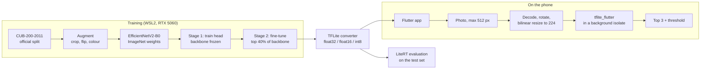

# BirdLens

An Android app that identifies 200 bird species from a photo, fully on the phone, using a TensorFlow Lite model I trained on CUB-200-2011.

<!-- SCREENSHOTS -->

## The problem

Bird ID apps usually send your photo to a server. I wanted to see how far a small model running entirely on the phone can go: no upload, works offline, and fast enough to feel instant. That meant training my own classifier, shrinking it for mobile, and checking that the phone gives the same answers as my Python evaluation.

## What the app does

- Take a photo or pick one from the gallery, and get the top 3 species with confidence bars.
- If the top guess is weak, it says so instead of pretending: "Not confident, this may not be one of the 200 species I know".
- Keeps a local history of scans (thumbnail, top guess, confidence, time) that you can delete.
- Has a benchmark screen that times the model on the device.
- Explains what the model can and can't do on an About screen.

<!-- RESULTS -->

## How it works

<!-- HOW -->

## Evaluation

<!-- EVAL -->

## Limitations

<!-- LIMITS -->

## Running it yourself

<!-- SETUP -->

## Author

Lucas Lee, Temasek Polytechnic.

Code is MIT licensed. The CUB-200-2011 images are not included and are for non-commercial research use. See [docs/model_card.md](docs/model_card.md).
